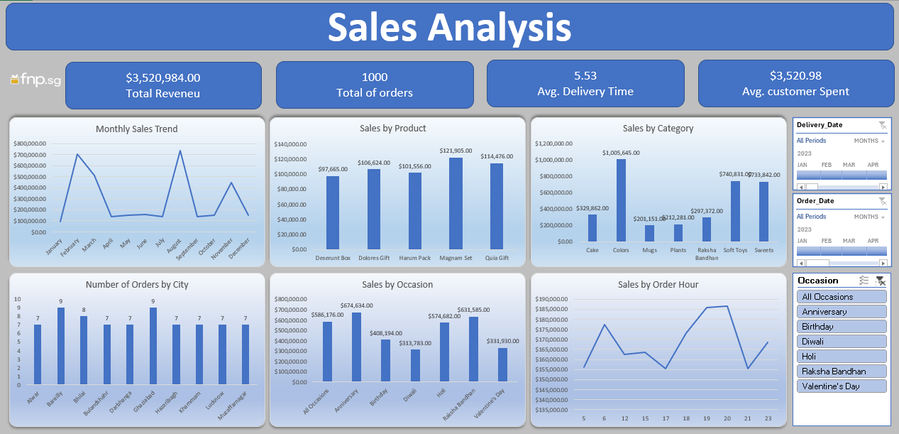

# 📈 Sales Analysis & Retail Performance Dashboard

An advanced Excel analytics project providing deep operational and financial insights into retail sales, customer behavior, and regional delivery performance.

## 📊 Dashboard Preview

## 📌 Project Overview
- **Objective:** Analyze retail transaction data to monitor total revenue, track order volumes, evaluate product and category performance, and optimize customer spending patterns.
- **Tools Used:** Excel, Advanced Formulas, Pivot Tables, Interactive Dashboards, Slicers.
- **Key Metrics Tracked:**
  - Total Revenue: **$3,520,984.00**
  - Total Orders: **1,000**
  - Average Delivery Time: **5.53 Days**
  - Average Customer Spend: **$3,520.98**
  - Monthly Sales Trends & Peak Hours
  - Sales Distribution by Product, Category, City, and Occasion

## 📂 Files in this Repository
- `Project Excel 2.xlsx`: The source dataset and interactive Excel dashboard workbook.
- `dashboard.png`: Visual preview of the sales analytics dashboard.
